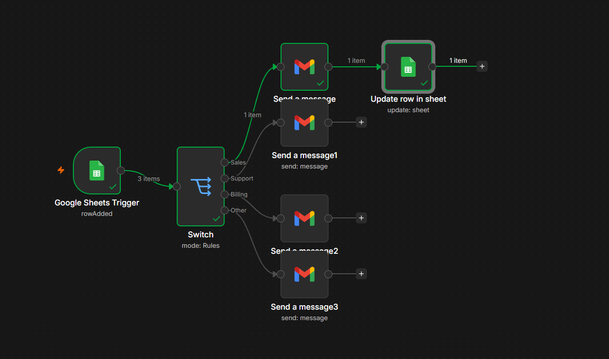

# Customer Support Ticket Router

## Overview

This n8n workflow automatically routes incoming customer requests to the appropriate department based on the category selected in a Google Form.

## Business Problem

Small businesses often receive sales, support, billing, and general inquiries in one shared inbox. Employees must manually review and forward every request, which slows down response times and creates a risk of missed tickets.

## Solution

The workflow receives a new request from Google Sheets, checks the selected department, and sends the ticket to the correct team automatically.

## Workflow

Google Form → Google Sheets Trigger → Switch → Gmail → Google Sheets

## Routing Logic

- **Sales** — routes pricing and service inquiries
- **Support** — routes technical support requests
- **Billing** — routes payment and invoice questions
- **Other** — routes general inquiries

## Features

- Automatic ticket categorization
- Department-based routing
- Email notifications
- Customer information included in each notification
- Automatic ticket status update in Google Sheets

## Technologies

- n8n
- Google Forms
- Google Sheets
- Gmail
- Switch routing logic

## Workflow Preview

## Files

- `workflow.json` — exported n8n workflow
- `workflow.png` — workflow preview

## Note

Credentials and account-specific identifiers are not included. Google credentials must be configured after importing the workflow.